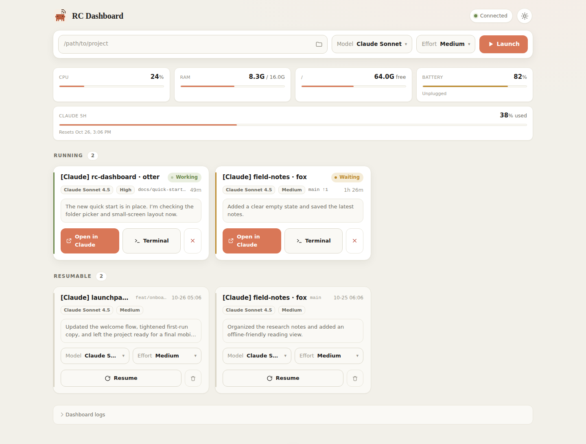
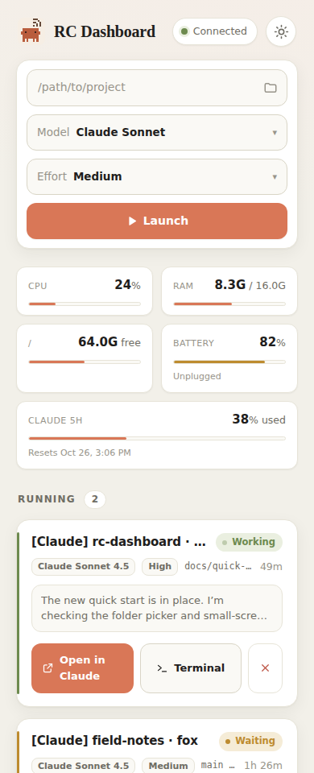
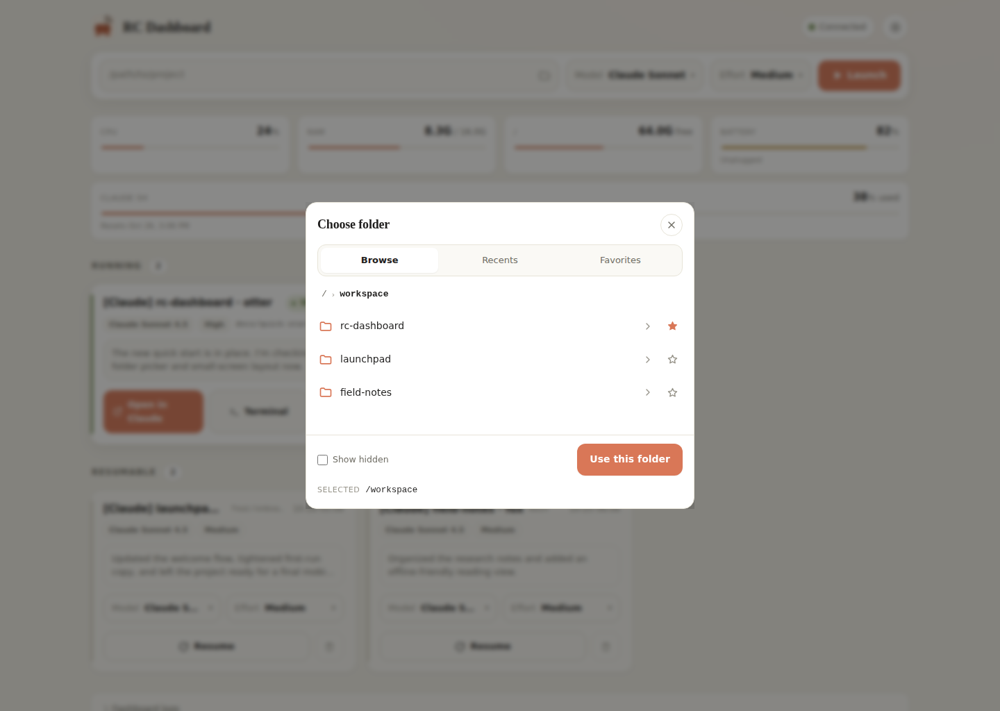
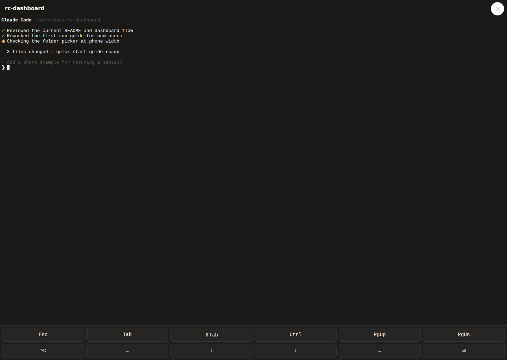

# RC Dashboard

  

<strong>Leave the terminal. Keep the thread.</strong>

Remote control for Claude Code.

Start a coding session on the machine where your project lives. Check its progress from another connected screen. Open the live terminal when it needs you. Close the dashboard when you’re ready; the session keeps running.

[Download RC Dashboard](https://github.com/ptrkhh/claude-dashboard/releases/latest) · [Quick start](#quick-start) · [Keep it private](#keep-it-private) · [Technical reference](#technical-reference)

## Start at your desk. Pick up anywhere you can connect.

A coding task can keep moving while you switch projects, leave your desk, or take a break. RC Dashboard keeps Claude Code sessions together in one clear view, so you can check in without babysitting a terminal.

- **See what’s happening.** Scan active and resumable sessions, recent replies, model, host health, and live logs. Usage meters and conversation summaries appear when available.
- **Step in when it matters.** Open a session’s real terminal, send the next instruction, or interrupt it. Close the terminal view and the session stays alive.
- **Pick up where you left off.** Resume a previous Claude Code session, then carry on with its project.
- **Use the screen that suits the moment.** Open the web dashboard, desktop app, or Android app.

## A look inside

<table>
  <tr><th align="center">Desktop</th><th align="center">Phone</th></tr>
  <tr>
    <td width="68%" valign="top"></td>
    <td width="32%" valign="top"></td>
  </tr>
</table>

<table>
  <tr><th align="center">Choose a project folder</th><th align="center">Step into a session</th></tr>
  <tr>
    <td valign="top"></td>
    <td valign="top"></td>
  </tr>
</table>

The dashboard UI is real; session names, stats, and terminal text are sample data.

## Quick start

1. [Download the app for your platform](https://github.com/ptrkhh/claude-dashboard/releases/latest).
2. On the machine where sessions will run, install tmux and Claude Code.
3. Open RC Dashboard. Linux and macOS desktop apps start the agent with the app. On Windows and Android, follow the one-time setup prompt for WSL or F-Droid Termux.
4. Choose a project, launch a session, and come back to it when you need to.

| Open RC Dashboard with | Sessions run on | First-run setup |
|---|---|---|
| Linux or macOS desktop app | Your computer | The app starts its included agent. |
| Windows desktop app | WSL 2 | The app guides you through starting the agent in your Linux distro. |
| Android app | F-Droid Termux on your phone | The app gives you a setup command to paste once. |
| Browser or installable web app | A computer running the agent | Open the local dashboard; configure protected network access before using another device. |

For browser-only use, start the agent on your host and open its local address. From source, the command is in the [technical reference](#run-from-source).

## Keep it private

RC Dashboard can control live coding sessions. The agent listens on your own machine by default, and authentication is off by default too. Keep it local, or add an access guard before opening it to a network. Saved remote profiles in the desktop and Android apps currently support unauthenticated agents only, so use those profiles on a trusted private network.

See [access and security settings](#access-and-security-settings) before exposing an agent to other devices.

## How it works

Your coding CLI and project stay on their host. RC Dashboard gives you a live window into the tmux session, then detaches cleanly when you close it. The session keeps running in the background.

    Start a task  →  Check in  →  Step into the terminal  →  Leave it running

## Technical reference

Platform details, session behavior, configuration, and build notes

### Run from source

The local agent serves the web dashboard at <strong>http://127.0.0.1:23274</strong>.

    cargo run -p cdash-agent

The desktop wrapper can be started with:

    cargo run -p cdash-tauri

The host needs tmux and Claude Code. Node.js 22 or later is needed for conversation summaries.

### Platform details

**Linux and macOS desktop.** The Tauri app starts the agent in-process. No separate server setup is needed.

**Windows desktop.** The app connects to the agent in WSL 2 over localhost. Start the Linux distro, install tmux and your coding CLI there, then paste the setup command shown by the app. Choose the x64 or ARM64 build that matches the Windows machine; WSL uses the host architecture.

**Android.** The app connects to an agent in F-Droid Termux. The Play Store Termux build cannot execute the agent from its private app directory. Install tmux and your coding CLI in Termux, then paste the setup command shown by RC Dashboard. The command installs or updates the agent and adds a shell guard so opening Termux starts it.

**Browser and PWA.** The agent serves the web app. It caches visited pages and assets for later offline viewing. Network access still requires a reachable host and a suitable access setup.

### Session behavior

Sessions run in tmux. The Terminal button attaches to the session’s live CLI interface; closing the view detaches without stopping the session. External sessions that are not in tmux do not have this control.

The browser terminal sends input to the CLI, so anyone who can reach it can control that session. Terminal connections check the page origin, and session APIs use the configured authentication guards. The log records terminal open and close events, not typed input.

### Claude Code sessions

Launch or resume Claude Code sessions from the dashboard. Model and effort choices come from the installed Claude Code CLI. When the Claude account supports usage lookup, meters use the same undocumented OAuth endpoint as the CLI; that endpoint may change. Missing credentials hide usage meters without blocking session controls.

Resumable cards can show conversation summaries. The agent reuses a suitable existing summary or generates one with the available supported subscription login. Summaries can omit or misstate details; the original session remains the source of truth. The selected conversation text is sent to the provider for summary generation. Tool payloads and thinking are omitted.

### Access and security settings

The agent defaults to **127.0.0.1** and **CDASH_AUTH=none**. If you enable network access, configure a guard or put the origin behind a trusted access layer. Claude sessions launch with broad permissions; treat access to the agent as access to your coding session.

The desktop and Android apps’ saved remote profiles currently support **auth: none**. Do not expose those connections to a public network. Android also does not isolate loopback between apps, so other apps with internet access on the phone may be able to reach a loopback agent.

| Setting | Default | Purpose |
|---|---|---|
| **PORT** | 23274 | Listening port. Set to 0 to choose an available port. |
| **CDASH_BIND** | 127.0.0.1 | Listen address. Network access requires an explicit bind address. |
| **CLAUDE_DIR** | ~/.claude | Claude configuration and project directory. |
| **DISK_EXTRA** | — | Optional second disk mount to report, such as /mnt/d. |
| **ANTHROPIC_BASE_URL** | https://api.anthropic.com | HTTPS base URL for Claude usage lookup. |
| **CDASH_AUTH** | none | Comma-separated guard chain: none, bearer, password, trusted-proxy, cf-access. Every configured guard must pass. |
| **CDASH_TOKEN** | — | Token for the bearer guard. |
| **CDASH_PASSWORD_HASH** | — | Password hash for the password guard; create it with cdash-agent set-password. |
| **CDASH_PUBLIC_URL** | — | Required HTTPS public URL when password auth uses a non-loopback bind. |
| **CDASH_ALLOW_INSECURE_COOKIE** | — | Set to 1 to allow password cookies over plain HTTP. |
| **CDASH_PROXY_ALLOW** | — | Allowed source addresses for trusted-proxy. |
| **CDASH_PROXY_HEADER** | X-Forwarded-Email | Identity header for trusted-proxy. The origin must only be reachable through that proxy. |
| **CDASH_CF_TEAM_DOMAIN** | — | Cloudflare Access team URL, required for cf-access. |
| **CDASH_CF_AUD** | — | Cloudflare Access application audience, required for cf-access. |
| **CDASH_LOGIN_PENDING_MAX** | 1024 | Maximum pending password logins. |

#### Cloudflare Access

Set **CDASH_AUTH=cf-access**, **CDASH_CF_TEAM_DOMAIN**, and **CDASH_CF_AUD** to validate Cloudflare Access tokens. Keep the origin reachable only through Cloudflare, such as with a tunnel or a firewall rule. If the origin may be reached directly, combine Cloudflare Access with password auth.

A tunnel that forwards only to loopback can use **CDASH_AUTH=none** because there is no inbound origin to bypass. Keep an auth guard if other local users or services share the host.

#### Android security note

Android apps share loopback access. The Android client cannot authenticate a saved remote profile yet, and the agent can control coding sessions. Use it only on a phone where you trust installed apps and keep remote access on a trusted private network.

### Release builds

The main build script produces the agents, desktop clients, and Android APK:

    scripts/toolchain.sh --accept-licenses
    scripts/build-all.sh

The toolchain is pinned in **scripts/toolchain-env.sh**. Use **scripts/build-all.sh --no-apk** when Android tools are not installed. The native desktop workflow builds Linux AppImages and a macOS DMG.

| Artifact | Target |
|---|---|
| cdash-agent | Linux x86_64 or ARM64 |
| cdash-tauri-linux-x64.AppImage | Linux desktop, x64 |
| cdash-tauri-linux-arm64.AppImage | Linux desktop, ARM64 |
| cdash-tauri.exe | Windows desktop, x64 or ARM64 |
| cdash-tauri-macos-arm64.dmg | macOS, Apple Silicon |
| cdash-dashboard-android-arm64.apk | Android, ARM64 |

The macOS DMG is unsigned, so Gatekeeper may require allowing it in Privacy & Security. The Android build is release-compiled and signed with the local SDK debug key; it is suitable for testing, not store distribution.

### Branding and icons

RC Dashboard uses the pixel Clawd mascot and S2 broadcast signal. Launcher icons use the fixed ink-and-apricot palette; the header and favicon follow the selected light or dark theme.

The editable web sources are **public/icon.svg** and **public/icon-light.svg**. The Tauri icon manifest is **crates/tauri-app/icons/source.json**. Regenerate native assets with the pinned Tauri CLI 2.12.1. Keep the PWA maskable artwork and Android foreground inside their safe regions.

