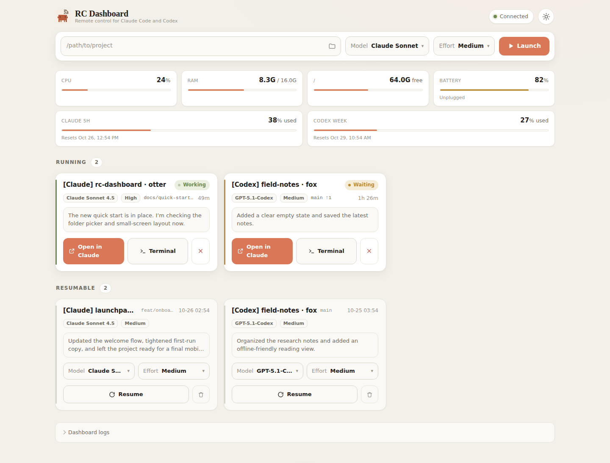
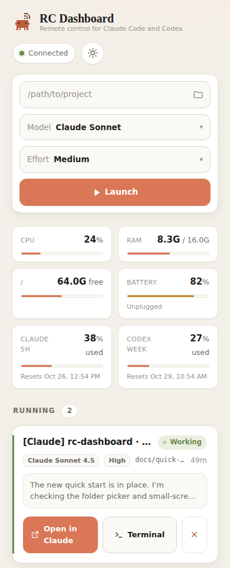
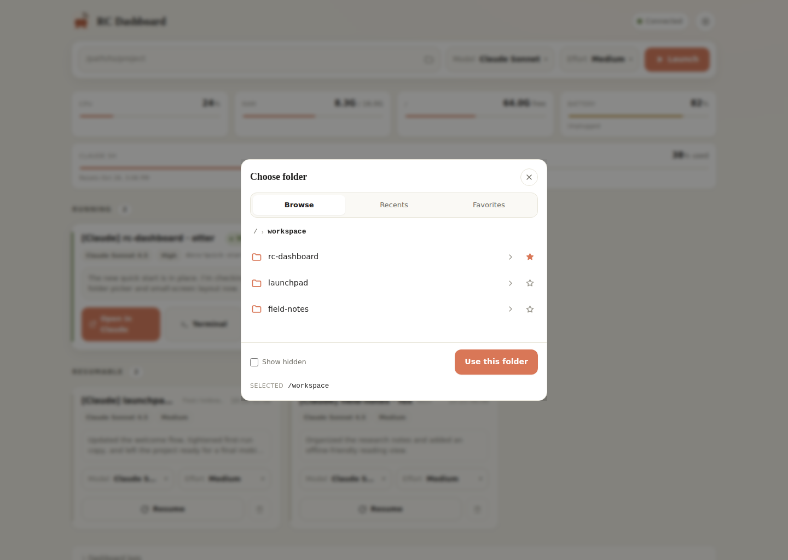
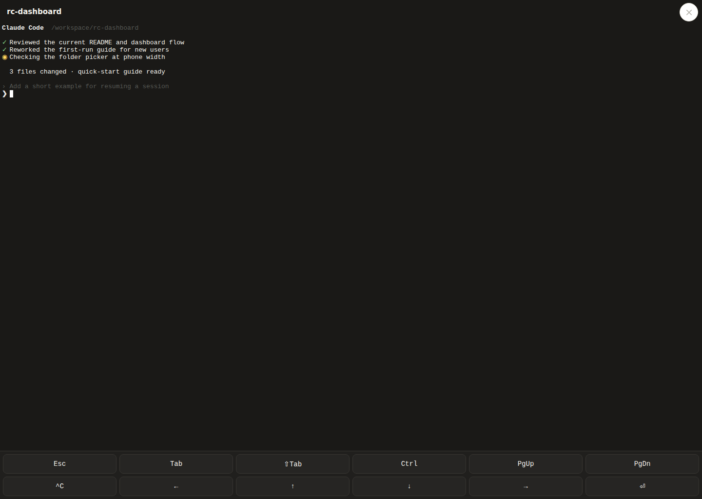

# RC Dashboard

<p align="center">
  
</p>

<p align="center"><strong>Start a session. Resume a project. Code from your phone.</strong></p>
<p align="center">The missing link for Claude Code Remote Control.</p>

[Claude Remote Control](https://code.claude.com/docs/en/remote-control) brings a running Claude Code session to the Claude app and website. **RC Dashboard handles the start and resume step:** choose a project, create a session or return to an earlier one, then tap **Open in Claude**.

After one-time setup, your everyday coding loop can happen entirely from RC Dashboard and Claude, without opening a terminal.

[Download RC Dashboard](https://github.com/ptrkhh/claude-dashboard/releases/latest) · [Quick start](#quick-start) · [Keep it private](#keep-it-private) · [Technical reference](#technical-reference)

## Get Claude going from the screen in your hand.

An idea arrives while you’re on the couch. Yesterday’s unfinished feature is waiting in another project. Open RC Dashboard, get the right session ready, and carry on in Claude.

- **Start something new.** Choose a project from your folders, recents, or favorites. Pick a model and effort level, then tap **Launch**.
- **Return to unfinished work.** Find a previous session, check its conversation summary when available, and tap **Resume** to pick up its context.
- **Keep coding in Claude.** Tap **Open in Claude** when the session is ready. Send instructions and follow the work in the Claude app or website through Remote Control.
- **Leave it running.** Close the dashboard and keep coding in Claude. Your session keeps running on its host.

Use the dashboard in your browser, on your desktop, or in the Android app. Running sessions, recent replies, usage meters, and host stats are there when you want a quick check.

## A look inside

<table>
  <tr><th align="center">Launch and resume on desktop</th><th align="center">Start from your phone</th></tr>
  <tr>
    <td width="68%" valign="top"></td>
    <td width="32%" valign="top"></td>
  </tr>
</table>

**Choose your next project.** Browse folders, revisit a recent project, or keep your favorites close.

<p align="center"></p>

<p align="center"><sub>The dashboard UI is real; session names and stats are sample data.</sub></p>

## Quick start

1. [Download the app for your platform](https://github.com/ptrkhh/claude-dashboard/releases/latest).
2. On the machine where your projects live, install tmux and Claude Code, and [sign in for Remote Control](https://code.claude.com/docs/en/remote-control#requirements).
3. Open RC Dashboard. Linux and macOS desktop apps start the agent with the app. On Windows and Android, follow the one-time setup prompt for WSL or F-Droid Termux.
4. Choose a project and tap **Launch**, or tap **Resume** on a previous session.
5. When the session is ready, tap **Open in Claude** and continue coding in the Claude app or website.

Installation and first-run setup may need a terminal. To sign in to Claude Code, Codex, or OpenCode on the host, choose **Terminal** in the Model menu and tap **Launch**: it opens a plain shell in tmux on the host, reachable from its card's **Terminal** button. Once setup is complete, use the dashboard to launch and resume sessions.

| Open RC Dashboard with | Sessions run on | First-run setup |
|---|---|---|
| Linux or macOS desktop app | Your computer | The app starts its included agent. |
| Windows desktop app | WSL 2 | The app guides you through starting the agent in your Linux distro. |
| Android app | F-Droid Termux on your phone | The app gives you a setup command to paste once. |
| Browser or installable web app | A computer running the agent | Open the local dashboard; configure protected network access before using another device. |

For browser-only use, start the agent on your host and open its local address. From source, the command is in the [technical reference](#run-from-source).

## Run in Docker

The image bundles the agent, Claude Code, Codex, OpenCode, and tmux. A second container runs cloudflared, so the dashboard is reachable only through a Cloudflare Tunnel with Cloudflare Access in front. cloudflared waits for the agent's local healthcheck before starting.

1. Copy `.env.example` to `.env` and fill it in.
2. In Cloudflare Zero Trust, create a tunnel and a public hostname that points at `http://tools:23274`. Create an Access application for that hostname with a policy that allows you. Put the tunnel token, team domain, and application audience tag in `.env`. **`CF_TEAM_DOMAIN` must be the full HTTPS issuer URL**, such as `https://example.cloudflareaccess.com`, with no trailing slash. A bare hostname causes the agent to exit with a JWKS fetch error and the container to restart.
3. Create the directory named by `PROJECTS_DIR` and put your projects in it, then start the stack:

       docker compose up -d --build

   Projects appear at `/home/node/projects` in the container. On Linux, the directory and project files must be writable by the container's `node` user (UID/GID 1000); creating a directory as another host user does not automatically grant that access.

4. Sign in once. In the launcher, choose **Terminal** in the Model menu, open the `projects` folder and pick a directory in it, and tap **Launch**. Open the new card's **Terminal** button and run `claude`, `codex`, or `opencode`. Claude Code must be signed in with an account that supports Remote Control.

The container starts with fresh CLI configuration. Host logins, plugins, trust lists, and permission settings are not imported. Configure each CLI inside the container, and set Git's `user.name` and `user.email` before committing. Dashboard-launched coding sessions set permissions on launch and resume: Claude Code uses `--dangerously-skip-permissions`, Codex bypasses approvals and sandboxing, and OpenCode uses `--auto` (explicit deny rules still apply). No saved permission configuration is needed for these defaults. The `home` volume preserves container logins, settings, and session history across rebuilds and `docker compose down`. `docker compose down -v` deletes that volume and its contents.

The agent runs as `node` with passwordless `sudo`, so project dependencies can be installed from the remote terminal. Elevated commands can modify mounted host files. System packages installed interactively survive a container restart, but disappear when the container is removed or recreated; add lasting dependencies to the Dockerfile. The image also disables Git's ownership check for repositories, so mount repositories you trust. This does not grant filesystem write permission.

Sessions run in tmux inside the container, so `docker restart`, `docker compose down`, and container replacement end them. Project files stay on the host. Cloudflare Access is the only guard: do not publish port 23274.

CLI versions have exact defaults in the Dockerfile's `CLAUDE_CODE_VERSION`, `CODEX_VERSION`, and `OPENCODE_VERSION` build arguments. Override a version with `docker compose build --build-arg CODEX_VERSION=<version>`, then run `docker compose up -d`. Keep OpenCode on v2. BuildKit caches Cargo downloads and compiled dependencies for subsequent builds; the first build still compiles them.

Use a separate tunnel for each independent dashboard stack. Cloudflare supports multiple connectors as replicas, but they must serve the same dashboard deployment; connectors pointing at independent stacks can send users to different code and session state. The default Compose project name is `cdash`; `-p` and `COMPOSE_PROJECT_NAME` can override it.

Before changing a project name, stop the old stack explicitly, for example `docker compose -p old-project down`. Do not add `-v` if you want to retain its home volume. A new project name normally selects a new, empty home volume. To reuse the old one after stopping the old stack, save an override such as `compose.home.yml`:

```yaml
volumes:
  home:
    external: true
    name: old-project_home
```

Replace `old-project_home` with the existing home volume's name, then start the new project with `docker compose -p new-project -f docker-compose.yml -f compose.home.yml up -d --build`. Include the override in subsequent Compose commands. Never run independent dashboard stacks against the same home volume.

To check a built image without CLI credentials or published ports, run `bash scripts/test-docker.sh rc-dashboard:local`.

## Keep it private

RC Dashboard can control live coding sessions. The agent listens on your own machine by default, and authentication is off by default too. Keep it local, or add an access guard before opening it to a network. Saved remote profiles in the desktop and Android apps currently support unauthenticated agents only, so use those profiles on a trusted private network.

See [access and security settings](#access-and-security-settings) before exposing an agent to other devices.

## How it works with Claude

RC Dashboard starts or resumes Claude Code on the machine where your project lives and gives you its Remote Control link. **Open in Claude** takes you to the coding conversation in Claude’s app or website.

Your code, tools, and environment stay on that host. Keep it on and reachable while you work remotely. Closing the dashboard leaves the session running.

External sessions without a Claude link show instructions instead of a waiting spinner. Run `/remote-control` in that session's original terminal to enable Remote Control; the card shows **Open in Claude** once the CLI publishes its link.

## Technical reference

<details>
<summary>Platform details, session behavior, configuration, and build notes</summary>

### Run from source

The local agent serves the web dashboard at <strong>http://127.0.0.1:23274</strong>.

    cargo run -p cdash-agent

The desktop wrapper can be started with:

    cargo run -p cdash-tauri

The host needs tmux and Claude Code. Node.js 22 or later is needed for conversation summaries.

### Platform details

**Linux and macOS desktop.** The Tauri app starts the agent in-process. No separate server setup is needed.

**Windows desktop.** The app connects to the agent in WSL 2 over localhost. Start the Linux distro, install tmux and your coding CLI there, then paste the setup command shown by the app. Choose the x64 or ARM64 build that matches the Windows machine; WSL uses the host architecture.

**Android.** The app connects to an agent in F-Droid Termux. The Play Store Termux build cannot execute the agent from its private app directory. Install tmux and your coding CLI in Termux, then paste the setup command shown by RC Dashboard. The command installs or updates the agent and adds a shell guard so opening Termux starts it. It also points the agent at Termux's CA certificate bundle without overriding a custom `SSL_CERT_FILE`; re-paste the setup command to apply this fix to an existing installation.

**Browser and PWA.** The agent serves the web app. It caches visited pages and assets for later offline viewing. Network access still requires a reachable host and a suitable access setup.

### Session behavior

Sessions run in tmux. Launching or resuming a session prepares its Remote Control link for **Open in Claude**. The dashboard also includes an optional **Terminal** button for direct access to the session’s live CLI interface; closing the view detaches without stopping the session. External sessions that are not in tmux do not have this control.

<p align="center"></p>

The browser terminal sends input to the CLI, so anyone who can reach it can control that session. Terminal connections check the page origin, and session APIs use the configured authentication guards. The log records terminal open and close events, not typed input.

### Claude Code sessions

Choose a model and effort level when launching or resuming Claude Code sessions. When the Claude account supports usage lookup, meters use the same undocumented OAuth endpoint as the CLI; that endpoint may change. Missing credentials hide usage meters without blocking session controls.

Resumable cards can show conversation summaries. The agent reuses a suitable existing summary or generates one with the available supported subscription login. Summaries can omit or misstate details; the original session remains the source of truth. The selected conversation text is sent to the provider for summary generation. Tool payloads and thinking are omitted.

### OpenCode sessions

To use OpenCode through the dashboard, install OpenCode V2.1.4 or later in the V2 series and Node.js 22 or later on the host. Configure and sign in to your OpenCode provider, and sign in to Claude Code with an account that supports Remote Control. Choose a project first, then select an OpenCode model and, when available, its variant. Model availability follows that project's OpenCode configuration. If `OPENCODE_CONFIG_CONTENT` is set, it must contain valid JSON for dashboard model discovery.

The dashboard starts a private OpenCode server and native terminal for each managed session. **Terminal** gives access to OpenCode's full interface; **Open in Claude** connects the same session to Claude Remote Control. The bridge carries text, tool activity and supported permission approvals. Use Terminal for attachments, interactive forms, and tool output beyond the bridge's 65,536-character limit. Reasoning is not forwarded.

Only OpenCode sessions created by this dashboard appear in its resumable history. Purging a card hides it from the dashboard; it does not delete the native OpenCode session. Do not run the same OpenCode session through another server at the same time. If Remote Control disconnects, the native terminal stays available while the link retries.

### Access and security settings

The agent defaults to **127.0.0.1** and **CDASH_AUTH=none**. If you enable network access, configure a guard or put the origin behind a trusted access layer. Coding sessions launch with broad permissions; treat access to the agent as access to your coding session.

The desktop and Android apps’ saved remote profiles currently support **auth: none**. Do not expose those connections to a public network. Android also does not isolate loopback between apps, so other apps with internet access on the phone may be able to reach a loopback agent.

| Setting | Default | Purpose |
|---|---|---|
| **PORT** | 23274 | Listening port. Set to 0 to choose an available port. |
| **CDASH_BIND** | 127.0.0.1 | Listen address. Network access requires an explicit bind address. |
| **CLAUDE_DIR** | ~/.claude | Claude configuration and project directory. |
| **DISK_EXTRA** | — | Optional second disk mount to report, such as /mnt/d. |
| **ANTHROPIC_BASE_URL** | https://api.anthropic.com | HTTPS base URL for Claude usage lookup. |
| **CDASH_AUTH** | none | Comma-separated guard chain: none, bearer, password, trusted-proxy, cf-access. Every configured guard must pass. |
| **CDASH_TOKEN** | — | Token for the bearer guard. |
| **CDASH_PASSWORD_HASH** | — | Password hash for the password guard; create it with cdash-agent set-password. |
| **CDASH_PUBLIC_URL** | — | Required HTTPS public URL when password auth uses a non-loopback bind. |
| **CDASH_ALLOW_INSECURE_COOKIE** | — | Set to 1 to allow password cookies over plain HTTP. |
| **CDASH_PROXY_ALLOW** | — | Allowed source addresses for trusted-proxy. |
| **CDASH_PROXY_HEADER** | X-Forwarded-Email | Identity header for trusted-proxy. The origin must only be reachable through that proxy. |
| **CDASH_CF_TEAM_DOMAIN** | — | Cloudflare Access team URL, required for cf-access. |
| **CDASH_CF_AUD** | — | Cloudflare Access application audience, required for cf-access. |
| **CDASH_LOGIN_PENDING_MAX** | 1024 | Maximum pending password logins. |

#### Cloudflare Access

Set **CDASH_AUTH=cf-access**, **CDASH_CF_TEAM_DOMAIN**, and **CDASH_CF_AUD** to validate Cloudflare Access tokens. Keep the origin reachable only through Cloudflare, such as with a tunnel or a firewall rule. If the origin may be reached directly, combine Cloudflare Access with password auth.

A tunnel that forwards only to loopback can use **CDASH_AUTH=none** because there is no inbound origin to bypass. Keep an auth guard if other local users or services share the host.

#### Android security note

Android apps share loopback access. The Android client cannot authenticate a saved remote profile yet, and the agent can control coding sessions. Use it only on a phone where you trust installed apps and keep remote access on a trusted private network.

### Release builds

The main build script produces the agents, desktop clients, and Android APK:

    scripts/toolchain.sh --accept-licenses
    scripts/build-all.sh

The toolchain is pinned in **scripts/toolchain-env.sh**. Use **scripts/build-all.sh --no-apk** when Android tools are not installed. The native desktop workflow builds Linux AppImages and a macOS DMG.

| Artifact | Target |
|---|---|
| cdash-agent | Linux x86_64 or ARM64 |
| cdash-tauri-linux-x64.AppImage | Linux desktop, x64 |
| cdash-tauri-linux-arm64.AppImage | Linux desktop, ARM64 |
| cdash-tauri.exe | Windows desktop, x64 or ARM64 |
| cdash-tauri-macos-arm64.dmg | macOS, Apple Silicon |
| cdash-dashboard-android-arm64.apk | Android, ARM64 |

The macOS DMG is unsigned, so Gatekeeper may require allowing it in Privacy & Security. The Android build is release-compiled and signed with the local SDK debug key; it is suitable for testing, not store distribution.

### Branding and icons

RC Dashboard uses the pixel Clawd mascot and S2 broadcast signal. Launcher icons use the fixed ink-and-apricot palette; the header and favicon follow the selected light or dark theme.

The editable web sources are **public/icon.svg** and **public/icon-light.svg**. The Tauri icon manifest is **crates/tauri-app/icons/source.json**. Regenerate native assets with the pinned Tauri CLI 2.12.1. Keep the PWA maskable artwork and Android foreground inside their safe regions.

</details>
